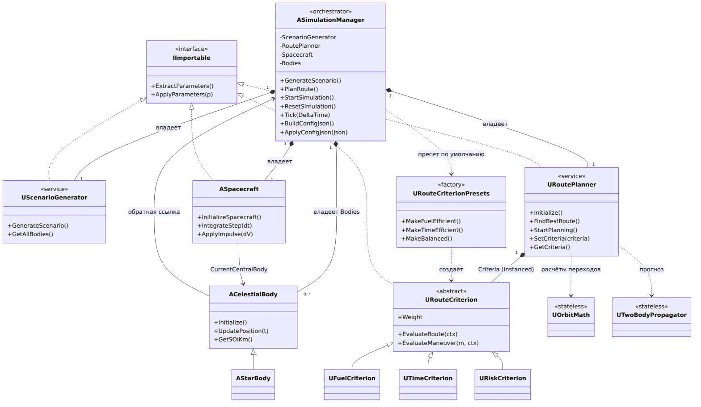
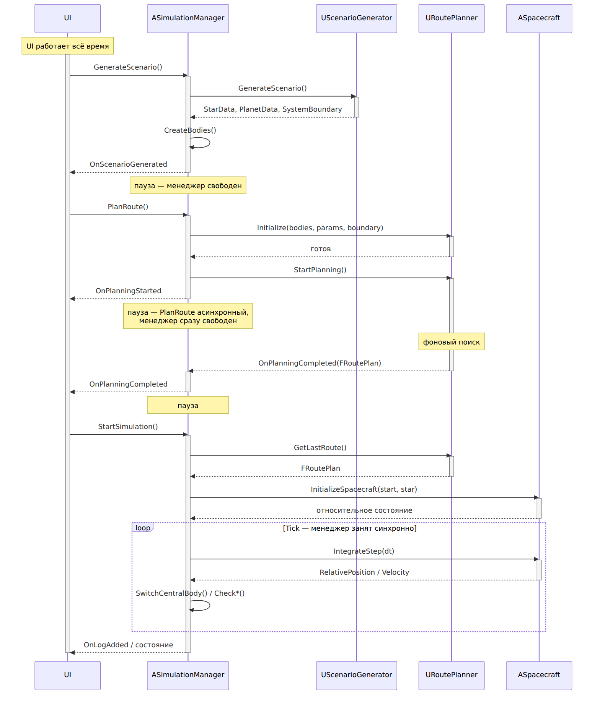

# Space Navigation Simulation

Проект на Unreal Engine 5 для генерации детерминированной планетной системы и
симуляции движения космического аппарата с планированием маршрута по критериям
Fuel / Time / Balanced (и другими при желании).

## Основное

- Детерминированная генерация по `Random Seed`: один и тот же seed даёт одну и ту же систему.
- Модель сфер влияния (SOI) и patched-conics переходы между телами.
- Критерии оптимизации вынесены в классы `URouteCriterion`. Планировщик не знает
  про конкретные критерии и просто суммирует их вклады:
  `TotalCost = sum(Weight_i * EvaluateRoute_i)`.
  - **Fuel Efficient** — один критерий `UFuelCriterion`, вес 1.
  - **Time Efficient** — один критерий `UTimeCriterion`, вес 1.
  - **Balanced** — `UFuelCriterion` 0.6, `UTimeCriterion` 0.3, `URiskCriterion` 0.1.
  - Каждый критерий нормирует свою оценку в `[0; 1]`, поэтому веса сравнимы.
- Два уровня оценки: `EvaluateManeuver()` для одного манёвра и `EvaluateRoute()`
  для всего маршрута. Базовая реализация `EvaluateRoute()` берёт среднее по
  манёврам, поэтому простому критерию достаточно переопределить её одну.

## Требования к запуску

- **ОС:** Windows 10/11 x64. Проект собирался и тестировался под Windows; macOS и
  Linux не проверялись.
- **Unreal Engine 5.8**.
- **Visual Studio 2022** с рабочей нагрузкой «Разработка игр на C++» (Game development
  with C++).

## Запуск

Загрузить уже собранный билд для Windows по ссылке - https://disk.yandex.ru/d/ZXQlK5cGx0cJ9A

ИЛИ открыть в редакторе:

1. Открыть `SpaceNavigation.uproject` в UE 5.8.
2. Открыть `Content/Levels/L_SimulationLevel.umap` (должен открыться по умолчанию).
3. Запустить игру в preview окне.

Настраивать параметры можно как в самой симуляции, так и в соответствующих ассетах: BP_ScenarionGenerator, BP_SimulationManager, BP_Spacecraft. и т.д.

## Архитектура

Центральный класс — `ASimulationManager`. Это композиционный корень: он
создаёт и держит все остальными объектами, а весь внешний код (UI,
Blueprint) работает через BP_SimController, который взаимодействует с менеджером. Остальные классы делятся на слои:

- **Акторы мира** (`AActor`): `ASimulationManager`, `ACelestialBody` /
  `AStarBody`, `ASpacecraft` — существуют в уровне.
- **Объекты-сервисы** (`UObject`): `UScenarioGenerator`, `URoutePlanner`,
  `URouteCriterion` — создаются менеджером, в мире не представлены.
- **Статические библиотеки** (`UBlueprintFunctionLibrary`): `UOrbitMath`,
  `UTwoBodyPropagator` — чистые функции без состояния.
- **Контракт импорта/экспорта**: интерфейс `IImportable` и структуры
  `FParameter` / `FParameters`.

### Диаграмма отношений



### Жизненный цикл



### SimulationManager как агрегатор

Менеджер владеет подсистемами через `TObjectPtr` и создаёт их сам:

- `ScenarioGenerator` (`UScenarioGenerator`) — детерминированная генерация
  системы по seed; отдаёт `StarData`, `PlanetData` и `SystemBoundary`.
- `RoutePlanner` (`URoutePlanner`) — поиск маршрута; менеджер только вызывает
  `Initialize()` / `StartPlanning()`, а прогресс получает по делегатам.
- `Spacecraft` (`ASpacecraft`) — актор аппарата, интегрируемый по шагам.
- `Bodies` (`TArray<ACelestialBody*>`) — созданные тела системы, `Bodies[0]` —
  звезда (`AStarBody`).

Типы конкретных классов задаются свойствами `TSubclassOf<...>`
(`ScenarioGeneratorClass`, `RoutePlannerClass`, `SpacecraftClass`,
`CelestialBodyClass`, `StarClass`), поэтому подсистемы заменяемы из Blueprint.
Тела держат обратную ссылку на менеджер, аппарат ссылается на текущее
центральное тело (`CurrentCentralBody`) — это и есть patched-conics привязка.

### Планировщик и критерии

`URoutePlanner` **композирует** набор критериев: массив `Critera` помечен
`UPROPERTY(Instanced)`. Планировщик ничего не знает о
конкретных видах критериев: в точке оценки он просто суммирует

```text
TotalCost = sum(Weight_i * EvaluateRoute_i)
```

switch по типам критериев отсутствует. Полиморфизм обеспечивают виртуальные
`EvaluateRoute()` / `EvaluateManeuver()` базового `URouteCriterion`; базовый
`EvaluateRoute()` по умолчанию берёт среднее по манёврам. Готовые наборы
режимов ("Fuel", "Time", "Balanced") собирает фабрика
`URouteCriterionPresets`. Если массив критериев пуст, подставляется пресет
`Balanced`.

Свойства, которые должен соблюдать критерий:

- детерминированность — оценка зависит только от контекста, без времени и случайных
  величин (по ТЗ один seed даёт одну и ту же конфигурацию);
- отсутствие состояния между вызовами;
- нормировка в `[0; 1]`, иначе веса разных критериев несравнимы.

`UOrbitMath` и `UTwoBodyPropagator` — статические библиотеки, которые
планировщик (и другие классы) использует для расчётов Хохмана/Ламберта, сфер
влияния и прогноза положения тел; общего состояния у них нет.

### Импорт/экспорт конфигурации

Единый контракт задаёт интерфейс `IImportable`:

```cpp
FParameters ExtractParameters();                   // объект -> параметры
bool        ApplyParameters(const FParameters&);   // параметры -> объект
```

`FParameters` — это `TArray<FParameter>` (имя, тип `EParamTypes`, значение,
единицы), т.е. слаботипизированный «мешок» значений, удобный для сериализации.
Интерфейс реализуют `UScenarioGenerator`, `ASpacecraft`, `URoutePlanner` и
`URouteCriterion` (подклассы критериев добавляют свои поля поверх базовых —
вес и т.п.).

`ASimulationManager` в регионе `ConfigFunctions` собирает из этого JSON:

- `BuildConfigJson()` / `ApplyConfigJson()` — корневой объект с секциями
  `Scenario`, `Spacecraft`, `Planner`;
- каждая секция — результат `ExtractParameters()` соответствующего объекта,
  прогнанный через `FJsonObjectConverter`
  (`UStructToJsonObject` / `JsonObjectToUStruct`);
- при импорте критерии пересоздаются по имени класса
  (`CreateCriterionFromJson`: `FindObject<UClass>` + `NewObject`), после чего к
  ним применяются параметры.

Диалоги выбора файла (`ChooseConfigFilePath`, `ExportConfigToJsonFile`,
`ImportConfigFromJsonFile`) используют модуль `DesktopPlatform`.

## Структура

| Путь | Назначение |
| --- | --- |
| `Public/Core/SimConstants.h` | Единицы, физические константы, пороги |
| `Public/Core/SimTypes.h` | Параметры сценария/аппарата, `FManeuver`, `FRoutePlan` |
| `Public/Core/RouteCriterion.h`, `Private/Core/RouteCriterion.cpp` | Классы критериев и пресеты Fuel / Time / Balanced |
| `Public/Core/OrbitMath.h`, `Private/Core/OrbitMath.cpp` | Гравитация, SOI, Хохман, биэллиптический переход, Циолковский |
| `Public/Core/TwoBodyPropagator.h`, `Private/Core/TwoBodyPropagator.cpp` | Распространение двухтельной задачи |
| `Public/Core/RoutePlanner.h`, `Private/Core/RoutePlanner.cpp` | Beam search по маршрутам, агрегация критериев |
| `Public/SimObjects/ScenarioGenerator.*` | Генерация системы по seed |
| `Public/SimObjects/CelestialBody.*` | Движение и состояние небесных тел |
| `Public/SimObjects/Spacecraft.*` | Аппарат, топливо, импульсы |
| `Public/SimObjects/SimulationManager.*` | Цикл симуляции, переключение SOI, набор критериев, исход миссии |


```cpp
Manager->SetCriterionPreset(TEXT("Balanced"));   // "Fuel" | "Time" | "Balanced"
Manager->SetCriteria(MyCustomCriteria);         // произвольный набор
```

Пустой набор не остаётся пустым: подставляется пресет `Balanced`.

## Единицы

Расстояние — км, масса — кг, время — с, скорость — км/с, ускорение — км/с².
Все вычисления в `double`: `float` не способен хранить 1.5e8 км с нужной точностью.

## Параметры по умолчанию

Значения подобраны так, чтобы сценарий по умолчанию был **выполним**:

- 4 планеты с шагом 0.5 AU от 0.4 AU → 0.9 / 1.4 / 1.9 / 2.4 AU.
- Граница системы — относительная: `K * максимальный орбитальный радиус` = 4.8 AU.
- Аппарат: сухая масса 40 т, топливо 200 т, Isp 900 с (ядерно-электрическая тяга).
- Старт с первой планеты, парковая орбита 400 км.

Расчёт: перелёт требует ≈12.6 км/с и ≈127 т топлива, аппарат располагает
15.8 км/с и 200 т — запас ≈25 % по ΔV.

Вариант из ТЗ `Target Distance = 120 AU` доступен через `bUseTargetDistance`,
но требует примерно в 7 раз большего расхода топлива и по умолчанию выключен.

*В билде есть json файл симуляции, при котором планировщик создает несколько маневров.

## Принятые упрощения

- Не N-body, а patched conics: тела движутся по кеплеровским орбитам.
- SOI считается по формуле `r_SOI = a * (m/M)^(2/5)` (Лаплас / Хилл).
- Маршрут разбит на манёвры «покинуть планету → перелёт → захват», заранее
  рассчитанные по Хохману. Скорости входящей и исходящей орбит не сопоставляются,
  поэтому **гравитационные манёвры в этой модели не дают выигрыша** — оптимальным
  обычно оказывается прямой перелёт к границе.
- Перелёт к границе системы — последний манёвр маршрута; он заканчивается
  на апоцентре, так как граница не привязана к телу.
- Полноценные N-body модель, сложные модели планет, рендеринг и автоматизированные
  бенчмарки в объём MVP не входят.